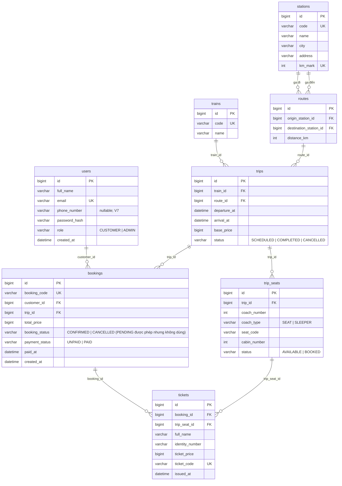

# ERD hiện tại của TrainGo

Bản dễ nhìn hơn (sơ đồ có màu, thẻ từng bảng): mở `erd.html` bằng trình duyệt.

Schema cập nhật 23/10/2026 theo V7: thêm `users.phone_number` nullable; V6 bỏ ngày sinh hành khách và phụ thu chỗ;
vé đã đặt giữ nguyên giá. Bảng `users` không có ngày sinh hoặc cờ xóa mềm.
Các bảng dữ liệu mẫu dưới đây là ảnh chụp lịch sử 20/10/2026, không phải kết quả
kiểm chứng sau V7; dữ liệu mẫu cũ chưa gồm phone. Nền dữ liệu theo migration `V5__north_south_line.sql`: ga có lý trình
`km_mark`, chuyến lưu giờ đi và giờ đến bằng ngày-giờ đầy đủ, dữ liệu mẫu là 8 ga
trên trục Bắc - Nam và lịch của tàu SE1. Lý do: `docs/decisions/0011-chuyen-tao-tu-tau-noi-chang.md`.

## Tổng quan các bảng

| Bảng | Chức năng |
| --- | --- |
| `stations` | Lưu thông tin các ga tàu. |
| `routes` | Lưu các tuyến đường giữa hai ga. |
| `trains` | Lưu thông tin các đoàn tàu. |
| `trips` | Lưu từng lần chạy của một tàu trên một tuyến. |
| `trip_seats` | Quản lý ghế, giường nằm và tình trạng chỗ trên từng chuyến. |
| `users` | Lưu tài khoản khách hàng và quản trị viên. |
| `bookings` | Lưu thông tin đơn đặt vé của khách hàng. |
| `tickets` | Lưu thông tin hành khách và vé tàu. |

## Sơ đồ

## Quan hệ giữa các bảng

| Bảng cha | Khóa ngoại ở bảng con | Bậc | Ý nghĩa |
| --- | --- | --- | --- |
| `stations` | `routes.origin_station_id` | 1 - N | Một ga là ga đi của nhiều tuyến. |
| `stations` | `routes.destination_station_id` | 1 - N | Một ga là ga đến của nhiều tuyến. |
| `trains` | `trips.train_id` | 1 - N | Một tàu chạy nhiều chuyến, chuyến sau nối tiếp chuyến trước. |
| `routes` | `trips.route_id` | 1 - N | Một tuyến có nhiều chuyến. |
| `trips` | `trip_seats.trip_id` | 1 - N | Một chuyến có 96 chỗ. |
| `users` | `bookings.customer_id` | 1 - N | Một khách có nhiều đơn. |
| `trips` | `bookings.trip_id` | 1 - N | Một chuyến có nhiều đơn. |
| `bookings` | `tickets.booking_id` | 1 - N | Một đơn có nhiều hành khách, mỗi hành khách một dòng tickets. |
| `trip_seats` | `tickets.trip_seat_id` | 1 - N | Một chỗ theo chuyến có thể nằm ở nhiều đơn theo thời gian (đơn cũ bị hủy, đơn mới lấy lại). |

## Chi tiết từng bảng

### Bảng stations – Ga tàu

**Mục đích:** Lưu thông tin các ga tàu trong hệ thống, bao gồm mã ga, tên ga, thành phố, địa chỉ và lý trình.

| Cột | Kiểu dữ liệu | Giải thích |
| --- | --- | --- |
| `id` | `bigint` (PK) | Mã ID của ga. |
| `code` | `varchar(10)` (UK) | Mã viết tắt của ga, ví dụ SGN. |
| `name` | `varchar(100)` | Tên đầy đủ của ga. |
| `city` | `varchar(100)` | Thành phố hoặc tỉnh nơi ga tọa lạc. |
| `address` | `varchar(255)` | Địa chỉ cụ thể của ga. |
| `km_mark` | `int` (UK) | Lý trình: số km tính từ ga Hà Nội theo đường sắt Thống Nhất. |

**Quy tắc:** Mỗi ga phải có mã riêng, không được trùng với ga khác. Thành phố và địa chỉ có thể để trống. Lý trình bắt buộc, không âm và không trùng giữa các ga. Mọi danh sách ga xếp theo lý trình, nên luôn đi từ Bắc vào Nam.

**Ví dụ:** Ga Sài Gòn có mã SGN, tên là Ga Sài Gòn, nằm tại TP. Hồ Chí Minh, lý trình km 1726.

**8 ga trong dữ liệu mẫu:**

| Mã | Ga | Lý trình (km) |
| --- | --- | --- |
| HNI | Hà Nội | 0 |
| THA | Thanh Hóa | 175 |
| VIN | Vinh | 319 |
| DHO | Đồng Hới | 522 |
| HUE | Huế | 688 |
| DNG | Đà Nẵng | 791 |
| NTR | Nha Trang | 1315 |
| SGN | Sài Gòn | 1726 |

**Dữ liệu mẫu (3 dòng đầu trong database):**

| id | code | name | city | address | km_mark |
| --- | --- | --- | --- | --- | --- |
| 9 | HNI | Ga Hà Nội | Hà Nội | 120 Lê Duẩn | 0 |
| 10 | THA | Ga Thanh Hóa | Thanh Hóa | NULL | 175 |
| 11 | VIN | Ga Vinh | Nghệ An | NULL | 319 |

### Bảng routes – Tuyến tàu

**Mục đích:** Lưu thông tin các tuyến đường từ một ga đến một ga khác, bao gồm ga xuất phát, ga đến và khoảng cách giữa hai ga.

| Cột | Kiểu dữ liệu | Giải thích |
| --- | --- | --- |
| `id` | `bigint` (PK) | Mã ID của tuyến. |
| `origin_station_id` | `bigint` (FK) | Ga xuất phát, lấy từ bảng stations. |
| `destination_station_id` | `bigint` (FK) | Ga đến, lấy từ bảng stations. |
| `distance_km` | `int` | Khoảng cách giữa hai ga, tính bằng km. |

**Quy tắc:** Ga đi và ga đến phải khác nhau. Khoảng cách phải lớn hơn 0. Không được tạo hai tuyến có cùng ga đi và ga đến.

**Ví dụ:** Tuyến Hà Nội → Thanh Hóa dài 175 km. Tuyến Thanh Hóa → Hà Nội được xem là một tuyến riêng vì đi theo chiều ngược lại.

Dữ liệu mẫu có 16 tuyến: 7 chặng giữa hai ga kề nhau, mỗi chặng 2 chiều, cộng tuyến Hà Nội ↔ Sài Gòn. Không có ga trung gian: muốn đi Hà Nội → Huế thì phải có tuyến Hà Nội → Huế.

**Dữ liệu mẫu (3 dòng đầu trong database):**

| id | origin_station_id | destination_station_id | distance_km |
| --- | --- | --- | --- |
| 9 | 10 (THA) | 9 (HNI) | 175 |
| 10 | 9 (HNI) | 10 (THA) | 175 |
| 11 | 11 (VIN) | 10 (THA) | 144 |

### Bảng trains – Đoàn tàu

**Mục đích:** Lưu thông tin các đoàn tàu đang được sử dụng trong hệ thống.

| Cột | Kiểu dữ liệu | Giải thích |
| --- | --- | --- |
| `id` | `bigint` (PK) | Mã ID của đoàn tàu. |
| `code` | `varchar(10)` (UK) | Mã tàu, ví dụ SE1. |
| `name` | `varchar(100)` | Tên của đoàn tàu. |

**Quy tắc:** Mỗi đoàn tàu có một mã riêng, không được trùng nhau. Tàu không gắn với tuyến nào: tuyến của tàu do các chuyến của nó quyết định.

Trong phiên bản TrainGo hiện tại, tất cả đoàn tàu đều có cùng một cách bố trí chỗ ngồi, được quy định sẵn trong chương trình:

| Toa | Loại chỗ | Số chỗ mỗi toa | Mã chỗ |
| --- | --- | --- | --- |
| 1–2 | Ghế ngồi (`SEAT`) | 32 | A01–A32 |
| 3–4 | Giường nằm (`SLEEPER`) | 16 | B01–B16, 4 giường/cabin |

Như vậy, mỗi đoàn tàu có 4 toa với tổng cộng 96 chỗ.

**Dữ liệu mẫu (cả 3 tàu trong database):**

| id | code | name |
| --- | --- | --- |
| 9 | SE1 | Thống Nhất 1 |
| 10 | SE2 | Thống Nhất 2 |
| 11 | SE3 | Thống Nhất 3 |

### Bảng trips – Chuyến tàu

**Mục đích:** Lưu từng lần chạy của một đoàn tàu trên một tuyến, bao gồm ngày giờ khởi hành, ngày giờ đến, giá vé và trạng thái chuyến.

| Cột | Kiểu dữ liệu | Giải thích |
| --- | --- | --- |
| `id` | `bigint` (PK) | Mã ID của chuyến tàu. |
| `train_id` | `bigint` (FK) | Đoàn tàu thực hiện chuyến đi. |
| `route_id` | `bigint` (FK) | Tuyến đường mà tàu sẽ chạy. |
| `departure_at` | `datetime` | Ngày giờ khởi hành. |
| `arrival_at` | `datetime` | Ngày giờ dự kiến đến ga cuối. |
| `base_price` | `bigint` | Giá vé cơ bản, tính bằng VNĐ. |
| `status` | `varchar(20)` | Trạng thái của chuyến tàu. |

**Các trạng thái:**

| Trạng thái | Ý nghĩa |
| --- | --- |
| SCHEDULED | Chuyến tàu đã được lên lịch. |
| COMPLETED | Chuyến tàu đã hoàn thành. |
| CANCELLED | Chuyến tàu đã bị hủy. |

**Quy tắc:**

- Giá vé cơ bản không được âm.
- Ngày giờ đến phải sau ngày giờ khởi hành. Vì cả hai cột đều lưu ngày, chuyến chạy qua đêm hoặc dài hơn 24 giờ vẫn lưu đúng.
- Chuyến được tạo từ trang tàu và phải nối chặng: ga đi của chuyến mới là ga đến của chuyến cuối cùng của tàu đó (không tính chuyến đã hủy), và giờ đi cách giờ đến của chuyến đó ít nhất 30 phút. Tàu chưa có chuyến nào thì chọn tuyến bất kỳ.
- Một tàu không bao giờ có hai chuyến chồng giờ.

**Ví dụ:** Tàu SE1 chạy Hà Nội → Thanh Hóa ngày 16/10/2026, khởi hành 08:00, đến 10:55, giá cơ bản 180.000đ. Chuyến kế tiếp của SE1 bắt buộc đi từ Thanh Hóa: ngày 17/10/2026 chạy Thanh Hóa → Vinh lúc 08:00.

**Lịch mẫu:** chỉ SE1 có chuyến, mỗi ngày một chặng lúc 08:00, đi 7 ngày xuống Sài Gòn rồi 7 ngày lên Hà Nội, tổng 18 chuyến. Ngày được tính từ lúc chạy migration, nên ngày trong bảng dưới là của lần chạy ngày 20/10/2026.

**Dữ liệu mẫu (3 chuyến đầu tiên theo giờ khởi hành):**

| id | train_id | route_id | departure_at | arrival_at | base_price | status |
| --- | --- | --- | --- | --- | --- | --- |
| 131 | 9 (SE1) | 10 (HNI → THA) | 2026-10-16 08:00:00 | 2026-10-16 10:55:00 | 180000 | COMPLETED |
| 133 | 9 (SE1) | 12 (THA → VIN) | 2026-10-17 08:00:00 | 2026-10-17 10:25:00 | 140000 | COMPLETED |
| 135 | 9 (SE1) | 14 (VIN → DHO) | 2026-10-18 08:00:00 | 2026-10-18 11:25:00 | 200000 | COMPLETED |

### Bảng trip_seats – Chỗ ngồi theo chuyến

**Mục đích:** Quản lý tất cả ghế ngồi và giường nằm của từng chuyến tàu, giúp hệ thống biết chỗ nào còn trống hoặc đã có người đặt.

| Cột | Kiểu dữ liệu | Giải thích |
| --- | --- | --- |
| `id` | `bigint` (PK) | Mã ID của chỗ trên chuyến tàu. |
| `trip_id` | `bigint` (FK) | Chuyến tàu chứa chỗ này. |
| `coach_number` | `int` | Số toa tàu, ví dụ toa 1, 2, 3, 4. |
| `coach_type` | `varchar(20)` | Loại toa: ghế ngồi hoặc giường nằm. |
| `seat_code` | `varchar(5)` | Mã chỗ, ví dụ A01 hoặc B01. |
| `cabin_number` | `int` | Số khoang, chỉ áp dụng cho toa giường nằm. |
| `status` | `varchar(20)` | Tình trạng hiện tại của chỗ. |

**Các trạng thái:**

| Trạng thái | Ý nghĩa |
| --- | --- |
| AVAILABLE | Chỗ còn trống, có thể đặt. |
| BOOKED | Chỗ đã được đặt. |

**Quy tắc:** Mỗi chuyến có 96 chỗ. Không được tạo trùng mã chỗ trong cùng một toa của cùng một chuyến. Chỗ chuyển sang BOOKED lúc thanh toán thành công, hệ thống không giữ chỗ tạm trước đó.

**Ví dụ:** Chuyến tàu số 131, toa số 1, ghế A01 đang có trạng thái AVAILABLE, nghĩa là khách hàng có thể chọn ghế này.

**Cách tính giá vé:** Giá vé bằng giá cơ bản của chuyến (`trips.base_price`), mọi chỗ trong cùng chuyến cùng một giá.

**Dữ liệu mẫu (3 chỗ đầu của chuyến 131):**

| id | trip_id | coach_number | coach_type | seat_code | cabin_number | status |
| --- | --- | --- | --- | --- | --- | --- |
| 11108 | 131 | 1 | SEAT | A01 | NULL | AVAILABLE |
| 11112 | 131 | 1 | SEAT | A02 | NULL | AVAILABLE |
| 11115 | 131 | 1 | SEAT | A03 | NULL | AVAILABLE |

### Bảng users – Người dùng

**Mục đích:** Lưu thông tin tài khoản dùng để đăng nhập và sử dụng hệ thống TrainGo.

| Cột | Kiểu dữ liệu | Giải thích |
| --- | --- | --- |
| `id` | `bigint` (PK) | Mã ID của người dùng. |
| `full_name` | `varchar(100)` | Họ và tên người dùng. |
| `email` | `varchar(255)` (UK) | Email dùng để đăng nhập. |
| `phone_number` | `varchar(15)` NULL | Số điện thoại; đăng ký khách bắt buộc 10 chữ số bắt đầu 0; ADMIN được null. |
| `password_hash` | `varchar(100)` | Mật khẩu đã được mã hóa bằng BCrypt. |
| `role` | `varchar(20)` | Vai trò của người dùng. |
| `created_at` | `datetime` | Thời gian tạo tài khoản. |

**Vai trò:**

| Vai trò | Ý nghĩa |
| --- | --- |
| CUSTOMER | Khách hàng sử dụng hệ thống để đặt vé. |
| ADMIN | Quản trị viên quản lý hệ thống. |

**Quy tắc:** Mỗi email chỉ được đăng ký một tài khoản. Mật khẩu được lưu dưới dạng đã mã hóa, không lưu trực tiếp mật khẩu gốc.

**Dữ liệu mẫu (3 dòng đầu trong database):**

| id | full_name | email | password_hash | role | created_at |
| --- | --- | --- | --- | --- | --- |
| 1 | Quản trị viên | admin@traingo.vn | (hash) | ADMIN | 2026-09-12 11:34:33 |
| 2 | Nguyễn Văn An | an.nguyen@example.com | (hash) | CUSTOMER | 2026-09-22 11:34:33 |
| 3 | Trần Thị Bình | binh.tran@example.com | (hash) | CUSTOMER | 2026-09-27 11:34:33 |

### Bảng bookings – Đơn đặt vé

**Mục đích:** Lưu thông tin mỗi lần khách hàng đặt vé tàu. Một đơn đặt vé có thể chứa vé cho nhiều hành khách nhưng chỉ thuộc một chuyến tàu.

| Cột | Kiểu dữ liệu | Giải thích |
| --- | --- | --- |
| `id` | `bigint` (PK) | Mã ID của đơn đặt vé. |
| `booking_code` | `varchar(20)` (UK) | Mã đơn đặt vé, ví dụ BK202610001. |
| `customer_id` | `bigint` (FK) | Khách hàng thực hiện đặt vé. |
| `trip_id` | `bigint` (FK) | Chuyến tàu được đặt. |
| `total_price` | `bigint` | Tổng tiền của đơn đặt vé. |
| `booking_status` | `varchar(20)` | Trạng thái của đơn đặt vé. |
| `payment_status` | `varchar(20)` | Trạng thái thanh toán. |
| `paid_at` | `datetime` | Thời gian thanh toán thành công. |
| `created_at` | `datetime` | Thời gian tạo đơn đặt vé. |

**Trạng thái đặt vé:**

| Trạng thái | Ý nghĩa |
| --- | --- |
| PENDING | Đơn đang chờ xử lý hoặc thanh toán. Database cho phép nhưng hiện chưa có luồng nào dùng. |
| CONFIRMED | Đơn đã được xác nhận. |
| CANCELLED | Đơn đã bị hủy. |

**Trạng thái thanh toán:**

| Trạng thái | Ý nghĩa |
| --- | --- |
| UNPAID | Chưa thanh toán. Database cho phép nhưng hiện chưa có luồng nào dùng. |
| PAID | Đã thanh toán thành công. |

**Quy tắc:** Mỗi đơn có một mã riêng. Tổng tiền không được âm. Đơn chỉ có thể được xác nhận khi đã thanh toán. Khi thanh toán thành công, hệ thống phải lưu thời gian thanh toán.

**Ví dụ:** Khách hàng Nguyễn Văn An đặt 2 ghế ngồi trên chuyến SE1 Thanh Hóa → Vinh ngày 17/10/2026, mỗi vé 140.000đ. Hệ thống tạo một đơn có tổng tiền 280.000đ.

**Dữ liệu mẫu (3 dòng đầu trong database):**

| id | booking_code | customer_id | trip_id | total_price | booking_status | payment_status | paid_at | created_at |
| --- | --- | --- | --- | --- | --- | --- | --- | --- |
| 24 | BK202610001 | 2 | 133 | 280000 | CONFIRMED | PAID | 2026-10-14 16:12:54 | 2026-10-14 16:12:54 |
| 25 | BK202610002 | 3 | 137 | 370000 | CONFIRMED | PAID | 2026-10-16 16:12:54 | 2026-10-16 16:12:54 |
| 26 | BK202610003 | 4 | 141 | 520000 | CONFIRMED | PAID | 2026-10-18 16:12:54 | 2026-10-18 16:12:54 |

### Bảng tickets – Vé tàu

**Mục đích:** Lưu thông tin từng hành khách và chỗ ngồi được đặt trong một đơn. Mỗi dòng tương ứng với một hành khách và một chỗ trên chuyến tàu.

| Cột | Kiểu dữ liệu | Giải thích |
| --- | --- | --- |
| `id` | `bigint` (PK) | Mã ID của vé. |
| `booking_id` | `bigint` (FK) | Đơn đặt vé chứa vé này. |
| `trip_seat_id` | `bigint` (FK) | Chỗ ngồi hoặc giường nằm được chọn. |
| `full_name` | `varchar(100)` | Họ và tên hành khách. |
| `identity_number` | `varchar(20)` | Số CCCD. |
| `ticket_price` | `bigint` | Giá tiền của vé. |
| `ticket_code` | `varchar(20)` (UK) | Mã vé điện tử sau khi thanh toán. |
| `issued_at` | `datetime` | Thời gian phát hành vé. |

**Quy tắc:** Trong cùng một đơn, không được thêm trùng một chỗ. Giá vé không được âm, bằng `trips.base_price` lúc đặt và không tính lại sau này. Chỉ thu thập họ tên và CCCD của hành khách. Dòng vé chỉ được tạo khi thanh toán thành công, cùng lúc với đơn, nên luôn có mã vé điện tử và thời gian phát hành.

Nếu đơn cũ bị hủy và chỗ được mở bán trở lại, khách hàng khác có thể đặt chỗ đó trong một đơn mới.

**Ví dụ:** Đơn BK202610001 có hai hành khách:

| Hành khách | Chỗ | Giá vé |
| --- | --- | --- |
| Nguyễn Văn An | Toa 1 – A01 | 140.000đ |
| Nguyễn Thị Mai | Toa 1 – A02 | 140.000đ |

Sau khi thanh toán thành công, mỗi hành khách nhận một mã vé điện tử riêng.

**Dữ liệu mẫu (3 dòng đầu trong database):**

| id | booking_id | trip_seat_id | full_name | identity_number | ticket_price | ticket_code | issued_at |
| --- | --- | --- | --- | --- | --- | --- | --- |
| 38 | 24 | 11396 | Nguyễn Văn An | 079095001234 | 140000 | TK202610001-01 | 2026-10-14 16:12:54 |
| 39 | 24 | 11400 | Nguyễn Thị Mai | 079197004321 | 140000 | TK202610001-02 | 2026-10-14 16:12:54 |
| 40 | 25 | 11922 | Trần Thị Bình | 001190006789 | 370000 | TK202610002-01 | 2026-10-16 16:12:54 |

